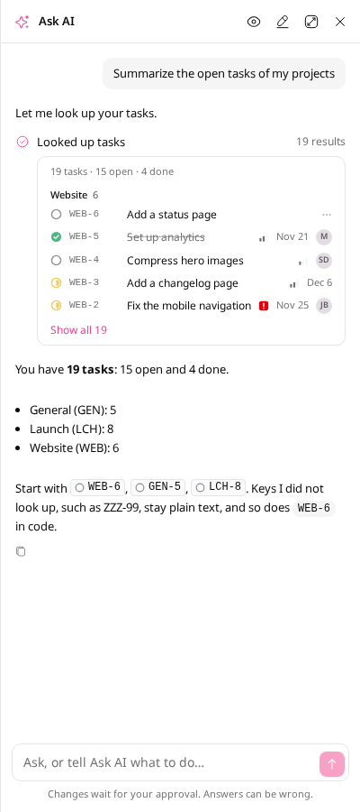
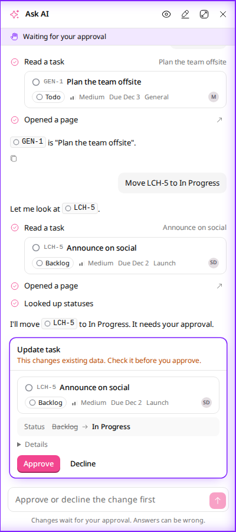
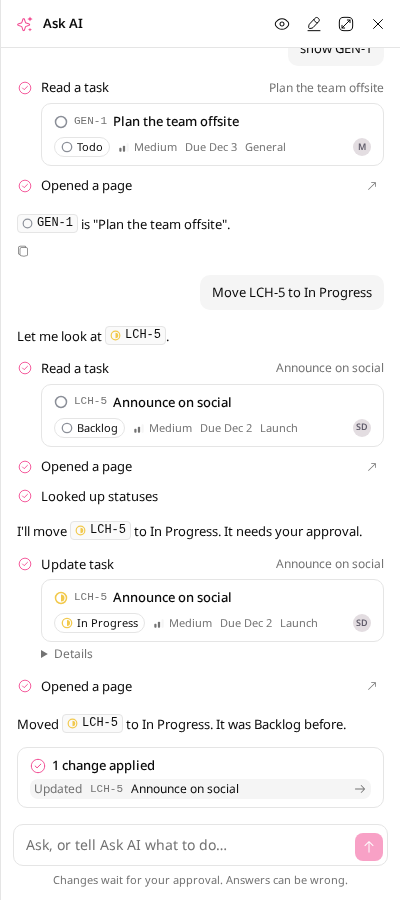

# Orbit

A self-hosted workspace for teams: tasks, docs, chat, and mail in one app on
your own server. AI clients connect over MCP and get the full context of your
workspace without your data leaving your server.

## Try Ask AI (fork)

> This is a fork of [coollabsio/orbit](https://github.com/coollabsio/orbit) with one addition: **Ask AI**, an in-app
> assistant. Everything else is upstream Orbit. It is published here so the maintainers and others can try it; it is
> not part of upstream Orbit.

**What it is.** A panel beside your page (the **Ask AI** row in the sidebar, or **Ctrl+J** / **Cmd+J**) that answers
questions about your tasks, docs and chats and makes changes for you, through the same tools as Orbit's MCP server,
as the signed-in member. Every change waits for your approval, and with **Follow along** on the page goes to what it
changed. It runs on Anthropic's Claude models with **your own Anthropic API key**.

**What it looks like.** Answers come as cards built by the server from the tool's own result, never from the model's
text: exact task counts and grouped lists, task keys that link to the task, and a before → after card for every change
that waits for your approval. While it works, a light travels around the window edge (blue for reading, amber for
changing, steady violet while it waits for you); with reduced motion nothing moves.

| Task list with exact counts | Approval: before → after | Summary of applied changes |
| --- | --- | --- |
|  |  |  |

Dark mode has the same cards: [approval card](docs/assets/ask-ai/approval-dark.png). The screenshots show demo data.
Details: [docs/assistant.md](docs/assistant.md).

**Run it.** Build and start it like upstream Orbit, from this branch:

- Docker: `docker build -t orbit-ask-ai .`, then run it as in [Self-hosting with Docker](#self-hosting-with-docker)
  with `orbit-ask-ai` in place of `ghcr.io/coollabsio/orbit:latest`.
- From source: `just setup`, then `just dev` (or `cargo build --release -p orbit-server`; the web app is embedded).
- Set `ORBIT_APP_KEY` (`openssl rand -base64 32`): the API key is sealed with it, and without it Orbit does not store
  one.
- Optional: `ORBIT_AI_ANTHROPIC_KEY` gives Ask AI a server-wide key for workspaces without their own. Every such
  workspace then spends that key (within its daily token limit, at most `ORBIT_AI_MAX_DAILY_TOKENS`), so use it only on
  a single-tenant server, never on a shared or cloud one.
- Optional: `ORBIT_AI_ANTHROPIC_BASE_URL` sends Ask AI through an Anthropic-compatible gateway (see
  [docs/assistant.md](docs/assistant.md) for its headers).
- As a workspace owner or admin, open **Settings → Integrations → AI**, paste your key from
  [console.anthropic.com](https://console.anthropic.com) (API keys), click **Test**, then **Save**. Pick a model
  (Claude Sonnet 5.5 by default) and a daily token limit. The mobile app has the same settings page; the chat panel
  is web-only for now.

**What it can do:** read tasks, projects, docs, views, databases and chat; create and update tasks, comments, docs,
projects, labels, statuses, milestones, cycles, views and database rows (each after your approval); open pages for
you. **What it cannot do:** delete, purge or trash anything; use mail; upload or download files; change project
membership; send anything outside the workspace; act beyond your own access.

**Security model**

- Every change pauses for approval of its exact arguments, which the server stores (the browser only answers
  approve or decline). "Allow in this chat" exists only for structured changes; anything that overwrites content or
  carries free text Orbit renders as Markdown (comments, descriptions, docs, database cells) always asks.
- Tool results, page context and your names reach the model marked as untrusted data inside a per-conversation
  nonce; answers load no outside images and draw no diagrams, so injected text cannot exfiltrate data through the
  browser.
- The key is sealed per workspace with `ORBIT_APP_KEY`, never returned to the browser (only its last four
  characters) and never logged. What Ask AI reads for a request is sent to Anthropic.
- Limits: 12 model steps and 20 tool calls per message, 4 minutes per run, 20 requests a minute per member, and a
  daily token limit per workspace (counted before each request; no request when the limits cannot be checked).
- Writes are audited as the member with `via: "assistant"`, plus an `assistant.change` row per applied, declined
  or failed change. Every MCP tool must carry a label in the assistant's registry (a test fails otherwise), so a new
  upstream tool stays unavailable until someone decides.

**Known limitations:** Anthropic only (the provider interface is ready for an OpenAI-compatible one, not built);
conversations (with a history per member) are kept 30 days, at most 100 per member and workspace, and are not
visible to anyone else, admins included; the daily limit is on tokens, not money
(set a spend limit in the Anthropic Console too); no chat panel in the mobile app yet. Details: [docs/assistant.md](docs/assistant.md).

**Known upstream test failures.** `cargo test -p orbit-server --lib assistant` passes on SQLite and Postgres. Four
tests in `apps/server/tests/mcp_api.rs` fail on this branch and fail the same way on upstream `main` (same command,
both databases), so Ask AI does not cause them: `docs_and_chat_require_explicit_scopes_and_doc_writes_need_docs_write`,
`mcp_route_is_mounted_in_the_application_and_rejects_oversized_bodies`,
`tools_list_includes_required_cache_fields_for_current_protocol` and `writes_are_refused_in_a_read_only_cloud_workspace`.

**How it was made.** Built with Claude Code (Anthropic) under the fork owner's direction; four independent AI-run
security reviews (each finding fixed and covered by tests) and an AI-run review of this branch; tested by hand by the
fork owner. Upstream: [coollabsio/orbit](https://github.com/coollabsio/orbit).

## Features

- **Tasks**: projects with custom workflows, list, board and timeline views,
  sub-issues, labels, saved views, trash, GitHub sync, and Asana, Linear and Trello import.
- **Docs**: page tree with live collaborative editing, version history, search,
  and Notion import.
- **Chat**: channels, direct messages, threads, files, and search.
- **Mail**: shared mail client (in progress, mock data).
- **AI**: [MCP server](docs/mcp.md) with OAuth. Read and write tasks and docs,
  read chat. Set it up in **Account settings → Agentic**.
- **Admin**: workspaces, members, roles, API tokens, audit log, email, rate
  limits, storage, and workspace export.
- **Backups**: scheduled, verified backups to S3, with restore of single pages
  or tasks.
- **Mobile**: iOS and Android app (`apps/mobile`). Saved views, timeline, tasks
  trash, GitHub settings, export, API tokens, and Notion, Asana, Linear and Trello import are web-only.

## How it works

One binary. A Rust server serves the API and the embedded React app. Data is in
SQLite (default) or Postgres, files on local disk or S3. Put a reverse proxy in
front for HTTPS. Docker image: `ghcr.io/coollabsio/orbit:latest`.

Set instance settings (mail server, S3 storage, Google and GitHub sign-in, open
registration, automatic backups) in Admin, or with `ORBIT_*` environment
variables for declarative deployments such as Kubernetes. A setting from a
variable is read-only in Admin. See [Deployment and operations](docs/operations.md).

## Self-hosting with Docker

The simplest setup: the Docker image, with SQLite in a volume. Needs Docker and
an HTTPS reverse proxy (for example Caddy) on the server.

```bash
sudo mkdir -p /etc/orbit
sudo tee /etc/orbit/orbit.env >/dev/null <<EOF
ORBIT_PUBLIC_ORIGIN=https://orbit.example.com
ORBIT_TRUSTED_PROXIES=127.0.0.1/32,172.17.0.1/32
ORBIT_APP_KEY=$(openssl rand -base64 32)
EOF
docker run -d --name orbit --restart unless-stopped \
  --env-file /etc/orbit/orbit.env -p 127.0.0.1:8080:8080 \
  -v orbit-data:/var/lib/orbit -v orbit-backups:/var/backups/orbit \
  ghcr.io/coollabsio/orbit:latest
docker logs orbit 2>&1 | grep 'setup URL'
```

Point the proxy at `127.0.0.1:8080`, open the setup URL, and create the root
account. Keep a copy of `ORBIT_APP_KEY` off the server. Details, variables,
backups and upgrades: [one Docker container (SQLite)](docs/self-hosting-sqlite.md).
Other setups: [Docker and Postgres](docs/self-hosting-postgres.md) and
[Docker Compose with Caddy](docs/self-hosting.md).

## Development

Needs Rust 1.97.1, Bun 1.4.4+, and [Just](https://just.systems/).

```bash
just setup
just dev   # http://127.0.0.1:8888
```

`just test` runs the tests, `just check` runs all checks.

## Docs

- [Self-hosting with one Docker container (SQLite)](docs/self-hosting-sqlite.md)
- [Self-hosting with Docker and Postgres](docs/self-hosting-postgres.md)
- [Self-hosting with Docker Compose and Caddy](docs/self-hosting.md)
- [Deployment and operations](docs/operations.md)
- [MCP server and client setup](docs/mcp.md)
- [GitHub integration](docs/github.md)
- [Chat incoming webhooks](docs/chat-webhooks.md)
- [Outgoing task webhooks](docs/webhooks.md)

## License

[Apache 2.0](LICENSE)
